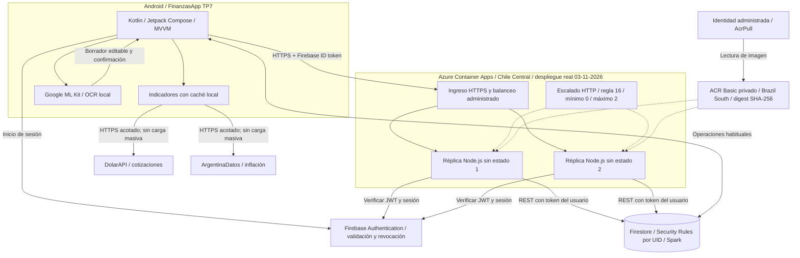

# Entregable 3 - Arquitectura actualizada

FinanzasApp TP3 v2 sobre la base TP7. Despliegue real del 03/11/2026, recursos **retirados y verificados**. Las dos réplicas son procesos bajo demanda: se observaron 0, 1 y 2 por API, no dos procesos permanentes. El portal identificó el entorno como Express/Rápido.

## Recorrido y alcance real

Android envía mes y token Firebase por HTTPS. Node verifica JWT y vigencia, deriva UID del token y consulta Firestore REST bajo Security Rules. DolarAPI/ArgentinaDatos quedan en Android con caché y ML Kit es local.

La linea base pertenece al primer despliegue; los tres niveles siguientes al segundo, con la misma imagen, region, CPU/memoria y limite de replicas. No son cuatro ensayos sobre el mismo entorno fisico. La segunda replica del baseline aparecio despues de terminar su carga, por lo que no se atribuye ese p95 a dos procesos. Las series no se interpolan.

Recursos retirados y verificados. Retiro verificado en `2026-11-03T05:37:03.5891270Z`. [Resultados y límites](07-resultados-cloud.md).
