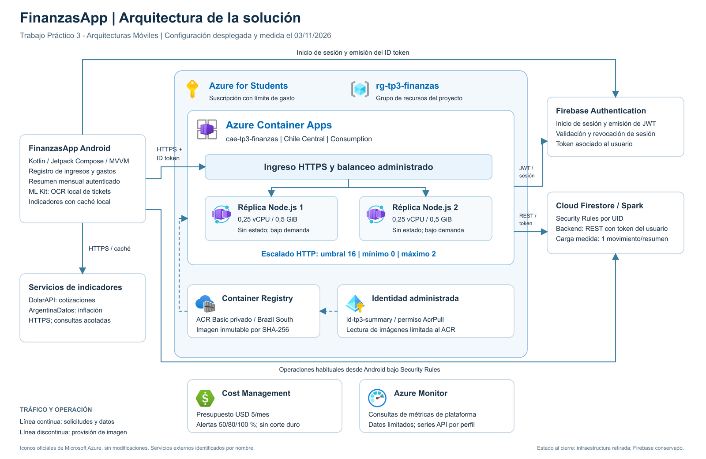

# Arquitectura de la solución

El diagrama utiliza los iconos oficiales de Microsoft para sus servicios Azure. Los componentes Android y Firebase se identifican como sistemas externos. Las líneas continuas representan solicitudes y datos; las discontinuas indican provisión de imágenes.

[SVG editable](arquitectura-azure.svg)

El plano completo se incluye al final del informe en una página apaisada y se entrega también en PDF, PNG y SVG editable.

## Recorrido de una solicitud

Android obtiene un ID token de Firebase Authentication y solicita el resumen por HTTPS. El ingreso administrado de Container Apps dirige la solicitud a una réplica. Node.js valida el token y la sesión, deriva el UID y consulta Firestore REST bajo Security Rules. La identidad administrada permite descargar la imagen desde ACR.

## Alcance de validación

Las consultas de Azure Monitor no aportaron CPU ni memoria verificables. La sonda directa solo cubre una réplica y una ventana breve del pico. El costo final contabilizado no está disponible. La carga representa un movimiento por resumen y no acredita meses de mayor volumen. No se comprobó redundancia zonal o regional ni distribución de solicitudes por instancia. El ensayo no incluye una prueba manual de Android u OCR en dispositivo.

Fuente de los iconos: [Microsoft Azure Architecture Center](https://learn.microsoft.com/en-us/azure/architecture/icons/). Se conservan proporciones, colores y formas oficiales.
