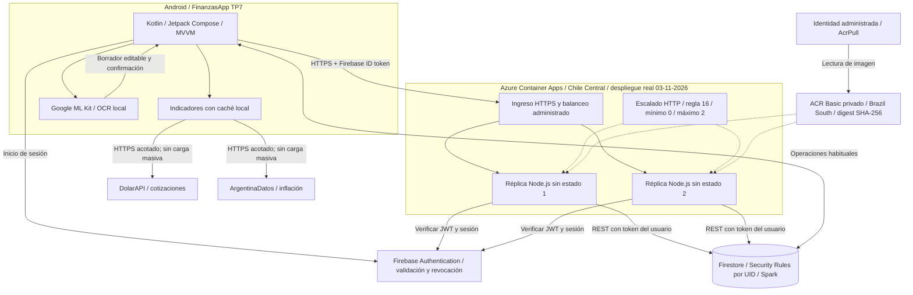

# Entregable 3 - Arquitectura actualizada

FinanzasApp TP3 v2 sobre la base TP7. Despliegue real del 03/11/2026, recursos **retirados y verificados**. Las dos réplicas son procesos bajo demanda: se observaron 0, 1 y 2 por API, no dos procesos permanentes. El portal identificó el entorno como Express/Rápido.

## Recorrido y alcance real

Android conserva Firebase Authentication, persistencia Firestore y las integraciones TP7. Para el resumen envía por HTTPS un ID token y mes. Node.js verifica JWT y vigencia de sesión, deriva el UID del token y consulta Firestore REST con ese mismo token bajo Security Rules. No utiliza credenciales administrativas Google en Azure.

El ingreso/balanceo y escalado son administrados por Azure Container Apps. La regla HTTP declarada tiene umbral 16 y rango 0-2. Se observó 0 -> 1 -> 2 -> 0, con la segunda réplica posterior a terminar la carga inicial. No se acreditó balanceo por instancia ni mejora de latencia con dos réplicas.

DolarAPI y ArgentinaDatos se consultan desde Android con caché y no recibieron carga masiva. ML Kit procesa OCR local, propone un borrador editable y requiere confirmación para guardar.

No se implementó redundancia zonal/regional ni se amplió a seis réplicas. Las cuotas Firebase no aumentan al escalar Azure. [Resultados reales y límites](07-resultados-cloud.md).
