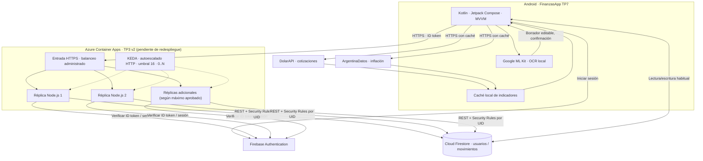

# Entregable 3 | Diagrama de arquitectura actualizado

**FinanzasApp TP3 v2, sobre TP7.** El diagrama a continuación representa la estructura de la versión preparada para la nube; **Azure aún no se ha desplegado** en esta revisión. Las réplicas dibujadas son instancias posibles, no un número permanente. Para un gráfico editable independiente ver [arquitectura.mmd](arquitectura.mmd).

## Recorrido de datos

1. Kotlin/Jetpack Compose obtiene un **Firebase ID token** al autenticar al usuario.
2. Para la tarjeta de resumen mensual, Android envía por HTTPS mes y token a Azure Container Apps.
3. El **ingreso HTTP administrado** distribuye las solicitudes entre réplicas Node.js saludables; KEDA ajusta la cantidad según la demanda y el límite definido.
4. Cada réplica verifica el token y estado de sesión, determina el UID del token validado, y consulta **Firestore REST con el token del propio usuario**. Las reglas de Firestore siguen aplicándose.
5. Se devuelven ingresos, gastos, saldo neto y cantidad de movimientos sin entregar todos los documentos a Android.

## Integraciones incorporadas en el TP7

- DolarAPI y ArgentinaDatos: **acceso HTTPS desde Android con caché local**; el backend Node.js no necesita ser intermediario de esas consultas.
- Google ML Kit: **OCR local**, candidato editable y confirmación explícita antes de registrar el gasto en Firebase.
- Firebase Auth y Firestore: autenticación y persistencia compartida; son dependencias que pueden limitar el escalado global.

## Balanceo, redundancia y estado real

Azure Container Apps mantiene el ingreso HTTPS y el autoescalador HTTP con mínimo cero y un máximo parametrizado: **2 por defecto**, configurable a más solo tras revisar cuotas y presupuesto. Una réplica disponible puede atender cualquier solicitud porque no conserva sesión en memoria. Esto aporta redundancia de procesos, **no asegura tolerancia a un fallo completo de zona o región**.

**Límites actuales:** no se ha validado redundancia regional, el indicador `/healthz` no prueba la disponibilidad de Firestore, y la escala no amplía las cuotas de Firebase ni los recursos de proveedores externos.

Ver el [procedimiento de Azure](04-procedimiento-azure.md) y el [informe integrado](05-informe-integrado.md) para estado y evidencia.
