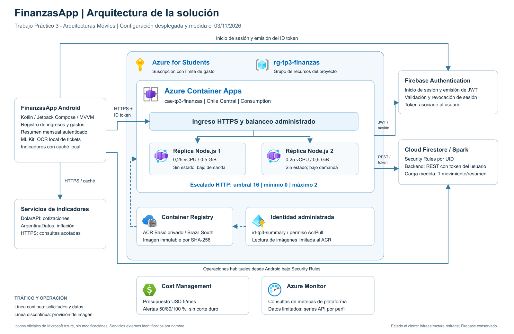

# Escalabilidad de FinanzasApp

UTN - Facultad Regional San Francisco
**Arquitecturas Móviles - 2026**

Ignacio Maidana y José Santino Arroyo
Docente: Juan Pablo Bono
Fecha: 3 de noviembre de 2026

## Objetivo y aplicación

FinanzasApp es una aplicación Android para registrar ingresos y gastos, consultar un resumen mensual, visualizar cotizaciones e inflación y reconocer tickets mediante OCR. Este trabajo diseña y evalúa la escalabilidad del servicio de resumen mensual mediante una infraestructura real en Azure.

Las capturas originales se incluyen en el PDF y en el paquete local de evidencias.

**Resultado principal:** 38.000 solicitudes de carga completadas sin errores, con un máximo observado de dos réplicas. El pico alcanzó 127,64 solicitudes/s; la meta de 160/s no quedó acreditada.

El documento distingue configuración, medición e interpretación. Los límites de observabilidad, facturación y validación en dispositivo se detallan junto con sus evidencias.

---

# Estrategia de escalabilidad

## Servicio y alcance funcional

Android solicita **GET /v1/summary?month=AAAA-MM** con un Firebase ID token. La API deriva el UID del token verificado, consulta los movimientos de ese usuario y devuelve ingresos, gastos, neto y cantidad. Utiliza importes enteros ARS y meses UTC. Limita la consulta a 1.000 movimientos y rechaza resultados parciales.

## Balanceo de carga

El ingreso HTTPS de Azure Container Apps recibe las solicitudes y las dirige a réplicas disponibles. Los procesos Node.js son sin estado: no almacenan sesiones ni resultados que obliguen a enviar un usuario a una instancia específica. El balanceo forma parte del servicio administrado; no se crea un recurso Azure Load Balancer independiente.

## Autoescalado y uso de recursos

La regla HTTP tiene umbral 16, mínimo 0 y máximo 2 réplicas. Cada réplica dispone de 0,25 vCPU y 0,5 GiB. El umbral guía al escalador; no constituye un tope estricto de solicitudes por proceso. El mínimo cero reduce consumo sin tráfico y admite una primera respuesta con arranque en frío.

## Redundancia y continuidad

Varias réplicas permiten atender solicitudes mediante procesos reemplazables. La configuración medida no garantiza redundancia entre zonas o regiones. Un requisito de continuidad más exigente necesitaría un diseño y una evaluación adicionales; no se atribuye esa garantía a dos procesos del mismo entorno.

Las capturas originales se incluyen en el PDF y en el paquete local de evidencias.

Ante crecimiento sostenido, evaluar consultas agregadas, caché o resúmenes precomputados. Agregar réplicas no amplía las cuotas de Firebase.

---

# Configuración cloud

Las capturas originales se incluyen en el PDF y en el paquete local de evidencias.

**Imagen desplegada:** commit de backend 8e5aeedfac0d35527e2c9bfb2d38a19123a14d30; digest sha256:b4e785288de3580f721699fde89e6692f0726e1a694f511c006458c8b121ecbd

Terraform declara siete recursos administrados. La operación crea primero el presupuesto y la infraestructura, pública la imagen privada y configura la aplicación. El estado se mantiene fuera del repositorio y las credenciales no se incorporan a la documentación.

La API valida JWT y vigencia de sesión. Accede a Firestore REST con el token del usuario bajo Security Rules; no utiliza credenciales administrativas Google en Azure. Los JSON de cada perfil identifican fecha, origen del servicio, commit y hash del verificador.

---

# Seguridad y metodología de ensayo

Las capturas originales se incluyen en el PDF y en el paquete local de evidencias.

Cada perfil repite estos controles con dos cuentas ficticias. La comprobación funcional crea diez movimientos y verifica ingresos 500, gastos 150, neto 350 y cantidad diez. Antes de la carga se eliminan nueve movimientos, de modo que cada resumen consulta uno. Los datos financieros reales no forman parte del ensayo.

Los cuatro perfiles requieren aproximadamente 38.000 lecturas más controles. Firebase utiliza Spark, con cuota compartida de 50.000 lecturas/día; el diseño del ensayo considera el consumo del proyecto. Esta carga no representa resúmenes de diez o mil movimientos.

Se revisan errores, limpieza, réplicas y costo entre niveles. El generador se detiene ante 429, diez errores consecutivos o diez fallos entre las últimas cien respuestas. DolarAPI y ArgentinaDatos no reciben carga masiva.

La consola de Firebase mostró 5,6 K lecturas en un intervalo que terminaba antes de alta/pico. Se conserva como lectura parcial con demora, no como total de los cuatro perfiles.

---

# Resultados de rendimiento

Las capturas originales se incluyen en el PDF y en el paquete local de evidencias.

Los totales programados y completados son 1.000, 5.000, 12.000 y 20.000. El máximo en curso es un límite del generador; se informa la concurrencia realmente observada. Solicitudes totales y usuarios simultáneos son magnitudes distintas.

Los percentiles abarcan desde el envío hasta leer y validar el JSON e incluirían las solicitudes fallidas, si existieran. La tasa efectiva utiliza la duración completa de la carga. Preparación, comprobaciones funcionales y limpieza quedan fuera de esa tasa.

## Interpretación

Se completaron 38.000 solicitudes con cero errores. El aumento de carga elevó los percentiles de latencia. El perfil pico alcanzó 127,64 solicitudes/s, un 79,8 % de las 160 solicitudes/s programadas; esta configuración no acredita sostener esa meta. La telemetría disponible no permite atribuir el límite a CPU, red o Firebase. Una sonda dentro de una réplica durante el final del pico puede agregar sobrecarga; su efecto no se descuenta de las mediciones.

Las mediciones abarcan dos sesiones de aprovisionamiento con la misma imagen y configuración. Los orígenes y tiempos originales permiten identificar cada ensayo; no se supone el mismo entorno físico para todos los perfiles.

La cantidad de solicitudes atendidas por cada instancia no se instrumentó. Las series de réplicas demuestran asignación y disponibilidad observadas; por sí solas no acreditan reparto de tráfico por instancia.

---

# Comportamiento del autoescalado

Series originales: [baseline](evidencias/azure-scale-baseline.json), [media](evidencias/azure-scale-media.json), [alta](evidencias/azure-scale-alta.json), [pico](evidencias/azure-scale-pico.json).

Puntos verdes: réplicas asignadas. Círculos naranjas: réplicas listas cuando difieren. Cada punto es una respuesta real de la API. El intervalo nominal de 5 s se amplía por la duración de cada consulta; no se completan espacios entre muestras.

Cada punto corresponde a una observación real; no se interpolan intervalos. Las mediciones abarcan dos sesiones de aprovisionamiento con la misma imagen, región, recursos por réplica y límite de escala. Los JSON identifican los orígenes y fechas. En baseline, la segunda réplica apareció después de finalizar la carga: su p95 no demuestra mejora por dos procesos.

---

# Métricas y observabilidad

Las capturas originales se incluyen en el PDF y en el paquete local de evidencias.

Las respuestas originales de Azure Monitor se conservan con su intervalo y dimensiones. Los valores cero o las series vacías no se reemplazan por los contadores del generador. La sonda directa cubre una réplica y no permite diagnosticar el cuello de botella del conjunto.

Las capturas originales se incluyen en el PDF y en el paquete local de evidencias.

Capturas originales: rango de réplicas y detalle de la regla HTTP. Las imágenes completas integran el paquete de evidencias.

---

# Costos y cierre operativo

El presupuesto mensual de USD 5 se configura antes de ACR y del entorno. Sus alertas alcanzan 50 %, 80 % y 100 % del importe. El límite general de la oferta estudiantil y el presupuesto son controles distintos: **el presupuesto no es un corte duro.**

Las capturas originales se incluyen en el PDF y en el paquete local de evidencias.

El presupuesto genera alertas y no detiene el consumo. La contabilización puede demorarse: un presupuesto con 0 USD y una consulta ActualCost sin filas no acreditan costo final cero. Las tarifas indicadas son referencias de cálculo, no una factura. Firebase utiliza el plan Spark.

## Cierre de la infraestructura de ensayo

La infraestructura se retiró después de respaldar las evidencias. La comprobación de Azure a las 2026-11-03T05:37:03Z confirmó siete recursos Terraform eliminados, grupo ausente, cero recursos propios y presupuesto propio ausente. Firebase se mantiene; las cuentas y los movimientos ficticios se limpiaron en cada perfil.

Los recursos se retiraron después de observar el retorno a cero y de conservar los resultados. El origen HTTPS registrado identifica el servicio utilizado durante las pruebas, no un endpoint que permanezca activo.

---

# Evidencias visuales

Las capturas originales se incluyen en el PDF y en el paquete local de evidencias.

Izquierda: crédito de la oferta mostrado en Educación de Azure durante la preparación. Derecha: aplicación en Chile Central, en cero réplicas al cierre de la carga; el visor presenta CPU/memoria sin datos y una alerta de transmisión de logs.

La captura original se incluye en la entrega local de evidencias.

Lista de Container Apps vacía, filtrada a Azure for Students y al grupo del proyecto. La API de recursos y el estado Terraform confirman adicionalmente la ausencia de los recursos propios y del presupuesto.

---

# Arquitectura de la solución

El diagrama utiliza los iconos oficiales de Microsoft para sus servicios Azure. Los componentes Android y Firebase se identifican como sistemas externos. Las líneas continuas representan solicitudes y datos; las discontinuas indican provisión de imágenes.

[SVG editable](arquitectura-azure.svg)

El plano completo se incluye al final del informe en una página apaisada y se entrega también en PDF, PNG y SVG editable.

## Recorrido de una solicitud

Android obtiene un ID token de Firebase Authentication y solicita el resumen por HTTPS. El ingreso administrado de Container Apps dirige la solicitud a una réplica. Node.js valida el token y la sesión, deriva el UID y consulta Firestore REST bajo Security Rules. La identidad administrada permite descargar la imagen desde ACR.

## Alcance de validación

Las consultas de Azure Monitor no aportaron CPU ni memoria verificables. La sonda directa solo cubre una réplica y una ventana breve del pico. El costo final contabilizado no está disponible. La carga representa un movimiento por resumen y no acredita meses de mayor volumen. No se comprobó redundancia zonal o regional ni distribución de solicitudes por instancia. El ensayo no incluye una prueba manual de Android u OCR en dispositivo.

---

# Evidencias y reproducibilidad

Cada JSON de carga conserva fecha UTC, origen del servicio, commit del verificador y SHA-256 de su código. La imagen se identifica mediante commit de backend y digest. Los registros permiten relacionar configuración, carga, observaciones y cierre. Buenos Aires corresponde a UTC-3.

Las capturas originales se incluyen en el PDF y en el paquete local de evidencias.

Credenciales, planes binarios y estado Terraform quedan fuera del paquete. Las capturas de cuenta y crédito se incluyen únicamente en la entrega local. Los registros originales se conservan sin reescritura editorial.

## Fuentes técnicas

[Iconografía oficial Azure](https://learn.microsoft.com/en-us/azure/architecture/icons/) - https://learn.microsoft.com/en-us/azure/architecture/icons/

[Escalado y métricas](https://learn.microsoft.com/en-us/azure/container-apps/scale-app) - https://learn.microsoft.com/en-us/azure/container-apps/scale-app

[Métricas de Container Apps](https://learn.microsoft.com/en-us/azure/container-apps/metrics) - https://learn.microsoft.com/en-us/azure/container-apps/metrics

[Presupuestos](https://learn.microsoft.com/en-us/azure/cost-management-billing/costs/tutorial-acm-create-budgets) - https://learn.microsoft.com/en-us/azure/cost-management-billing/costs/tutorial-acm-create-budgets

[Cuotas Firestore](https://firebase.google.com/docs/firestore/quotas) - https://firebase.google.com/docs/firestore/quotas

[CPU de cgroup](https://docs.kernel.org/admin-guide/cgroup-v2.html) - https://docs.kernel.org/admin-guide/cgroup-v2.html

[Memoria de procesos](https://docs.kernel.org/filesystems/proc.html) - https://docs.kernel.org/filesystems/proc.html
