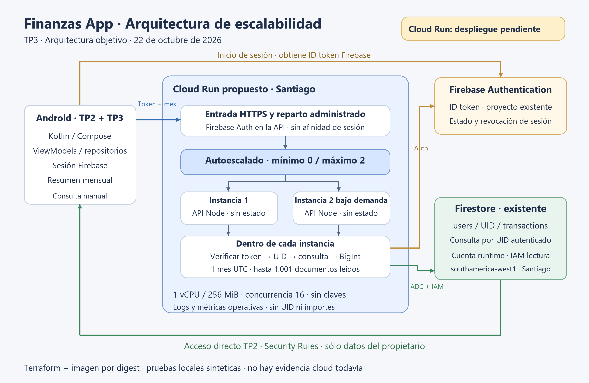
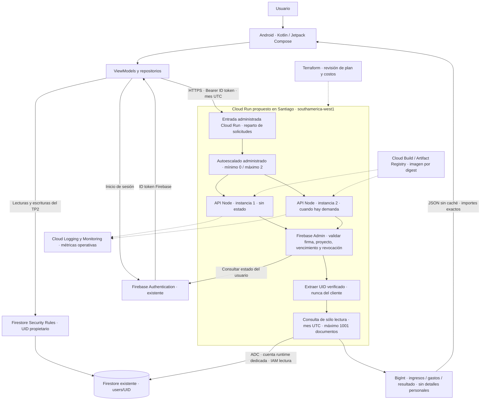

# TP3 · Diagrama de arquitectura actualizado

**Leyenda:** componentes Firebase/Android pertenecen al TP2. La API y la
infraestructura del TP3 están implementadas en código; Cloud Run aún no se ha
desplegado. El diagrama describe el destino propuesto, no recursos ya observados.

## Lectura del diagrama

El balanceo y escalado son capacidades administradas de Cloud Run, representadas
como mecanismos lógicos; no son contenedores adicionales ni recursos dedicados
de balanceador externo. Las dos instancias ilustran la capacidad bajo demanda;
con mínimo cero puede no existir ninguna en reposo.

La verificación y el cálculo se ejecutan dentro de cada instancia. Se dibujan
separados para explicar el flujo; no existe un servicio central de verificación
propio que actúe como punto único de fallo. Firebase Auth/Firestore son servicios
administrados compartidos y sus límites siguen siendo dependencias del sistema.

Cada instancia acepta hasta 16 solicitudes concurrentes, tiene 1 vCPU y 256 MiB.
Las solicitudes no requieren afinidad, disco compartido ni sesión en memoria.
Cloud Run administra la ejecución y recuperación regional; esta propuesta no
incorpora recuperación activa en otra región. Firestore es una base regional en
Santiago, verificada en consola; las copias programadas aparecen inhabilitadas.

## Fronteras de confianza

- Android obtiene un token y envía sólo el mes; el backend no acepta UID externo.
- El acceso directo del TP2 usa Security Rules. El backend usa ADC e IAM;
  Admin SDK omite las reglas, por lo que impone su propia ruta por UID verificado.
- No hay claves de servicio dentro del APK, imagen o repositorio nuevo.
- Los logs propios contienen duración y estado, sin token, UID ni importes.
- Las pruebas usan emuladores y datos sintéticos en un proyecto `demo-*`.

## Componentes por validar en el despliegue

Región, imagen por digest, cuenta de ejecución y permisos efectivos; revisión
saludable, límites de instancias, concurrencia y reparto de solicitudes; políticas
vigentes de Firestore, facturación y alertas. Ver la [matriz de evidencia](02-configuracion-cloud.md).
