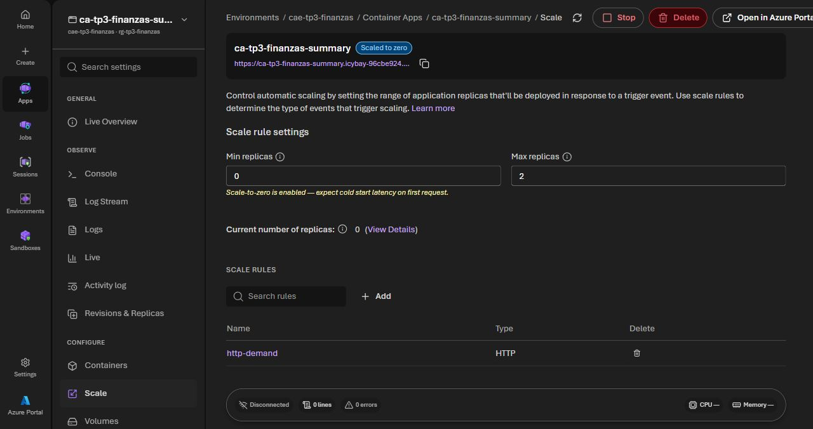
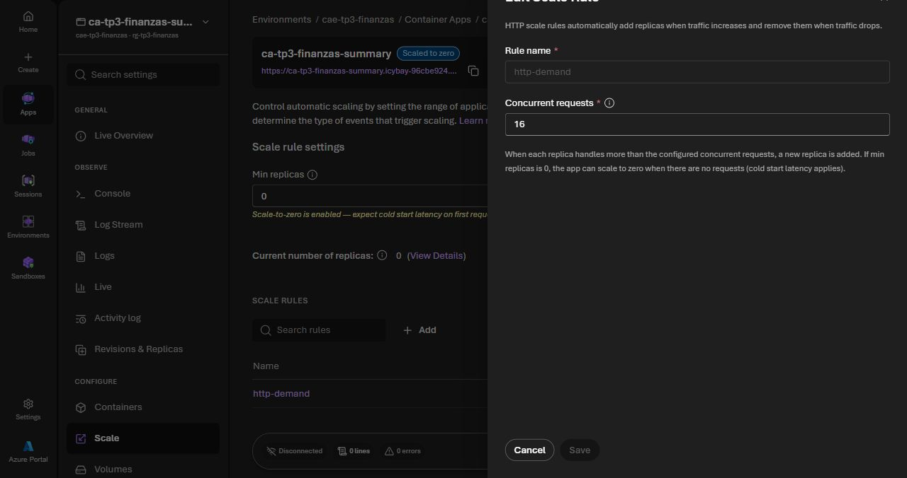

# TP3 · Configuración cloud y evidencia

Fecha: 22/10/2026. Configuración aplicada desde [`infra/azure`](../../../infra/azure).
La API se desplegó después de autorizar uso de crédito con presupuesto de control
USD 5 y ventana de demostración de 24 h. Los tiempos de evidencia están en UTC;
en Argentina la ejecución corresponde al 22/10/2026.

## Estado comprobado

| Elemento | Evidencia y estado |
|---|---|
| Azure para Estudiantes | Revisión inicial: USD 100 de USD 100 disponibles, consumo del mes USD 0; vencimiento 22/10/2027. No representa el costo posterior al despliegue |
| Recursos TP3 en Azure | Grupo, entorno Express, identidad, registro privado y API creados con Terraform |
| Firebase | Proyecto `finanzasapp-1f76a`, Spark, sin facturación vinculada |
| Firestore | Native Standard, regional Santiago `southamerica-west1`; reglas por UID e índices automáticos observados |
| Regiones efectivas | Servicio en `chilecentral`; registro en `brazilsouth`; ambas permitidas por la política estudiantil |
| Despliegue y balanceo | API HTTPS activa, revisión única, ingress administrado sobre réplicas saludables |
| Autoescalado | Configuración 0–2, umbral HTTP 16; observado 1 → 2 (ambas listas) → 0 sin tráfico |
| Sesiones y datos | Resumen 200, sin sesión 401, UID inyectado 400, lectura cruzada Firestore 403, sesión revocada 401 |
| Carga real sintética | 1.000 consultas, 0 errores, p95 883 ms; dos cuentas y sus documentos eliminados |

La oferta descuenta del crédito el consumo que exceda las cantidades gratuitas.
Cuando se agota el crédito, Azure deshabilita la suscripción salvo que se cambie
a pago por uso. No se propone ese cambio. [Condiciones operativas oficiales](https://learn.microsoft.com/azure/cost-management-billing/manage/azurestudents-subscription-disabled).

## Recursos desplegados

| Recurso | Configuración aplicada |
|---|---|
| Grupo `rg-tp3-finanzas` | Agrupa exclusivamente recursos TP3, etiquetas de finalidad |
| Registro de contenedores | Basic privado en Brazil South, nombre único, administrador desactivado; ACR Tasks no disponible en Chile Central |
| Identidad `id-tp3-summary` | Sólo `AcrPull` sobre ese registro |
| Entorno `cae-tp3-finanzas` | Perfil Consumption, sin perfiles Dedicated, VNet, Private Endpoint ni workspace Log Analytics nuevo |
| App `ca-tp3-finanzas-summary` | Imagen privada por digest, revisión única, HTTPS público, puerto interno 8080 |
| Escalado | Mínimo 0, máximo 2, umbral HTTP 16; 0,25 vCPU / 0,5 GiB |
| Firebase | ID del proyecto existente; `FIREBASE_DATA_ACCESS=user-rest`, clave cliente en variable local |

La entrada pública es necesaria para Android. `/healthz` no divulga datos y el
resumen requiere un ID token válido. No se abre Firestore ni se cambian sus reglas.
La suscripción aprovisiona entornos Express y rechazó el destino `azure-monitor`.
Se omite `logs_destination`: sólo streaming, sin almacén ni retención adicional.
Capturar métricas de plataforma; cualquier retención debe presupuestarse aparte.

La API Express omite el reparto explícito de tráfico de revisión única, el
protocolo HTTP implícito de la sonda y los valores de sondeo/recuperación que
administra la plataforma. Terraform ignora exclusivamente esas diferencias de
lectura para evitar cambios perpetuos. Siguen controlados HTTPS, revisión única,
imagen, variables de autenticación, identidad, regla HTTP y límites de réplicas.
No se afirma controlar tiempos internos de Express a partir de esos campos omitidos.

No se usan claves de cuenta de servicio Google ni contraseñas ACR. El estado de
Terraform, ID de suscripción y variables cliente se mantienen locales y fuera de
Git. La clave cliente no es una credencial administrativa; revisar sus
restricciones de API/aplicación antes de comprobar `accounts:lookup` desde Azure.
Si impiden el uso, detenerse y revisar sin eliminar protecciones automáticamente.

## Costos y límite acordado

Precios públicos consultados para Chile Central en USD, 22/10/2026, conservados en
[`azure-retail-prices.json`](../evidence/azure-retail-prices.json).
Son tarifas de referencia; no son una factura de esta cuenta.

El registro se ubica en Brazil South porque ACR Tasks rechazó Chile Central.
Se verificaron las mismas tarifas Basic y Tasks en
[`azure-registry-brazil-prices.json`](../evidence/azure-registry-brazil-prices.json).
El reemplazo del registro vacío inicial puede agregar consumo parcial del registro;
el presupuesto de control contempla estos reintentos.

ACR Tasks también devolvió `TasksOperationsNotAllowed` para la oferta estudiantil
en Brazil South. Se usa la imagen construida y probada en GitHub Actions, exportada
como artefacto privado de un día. Se verifica SHA-256 al descargarla y se sube con
`crane` y un token temporal obtenido mediante la sesión local de Azure CLI.
No se entregan credenciales Azure a GitHub ni se crea otra identidad con escritura.
El token local se retira del almacén de `crane` al terminar. Los intentos de Tasks
fueron rechazados antes de iniciar una ejecución de construcción.

| Concepto | Tarifa observada | Escenario de demostración |
|---|---:|---:|
| CPU activa | 0,000034 por vCPU-s | Dos réplicas de 0,25 vCPU durante 1 h: USD 0,0612 |
| Memoria activa | 0,000004 por GiB-s | Dos réplicas de 0,5 GiB durante 1 h: USD 0,0144 |
| Solicitudes | USD 0,40 por millón | 1.000: USD 0,0004 |
| Registro Basic | USD 0,1666 por día | 1 día: USD 0,1666 |
| ACR Tasks (referencia; bloqueado, no ejecutado) | USD 0,0001 por vCPU-s | No se usó para construir la imagen final |

Subtotal ilustrativo **USD 0,2426** para cómputo/solicitudes del escenario y un
registro durante un día, sin descontar franquicias ni incluir tráfico,
almacenamiento adicional, reintentos o servicios no previstos. El registro se
sigue cobrando aunque la app escale a cero, hasta eliminarlo. La franquicia de
Container Apps puede cubrir cómputo/solicitudes de esta demostración, según el
consumo de toda la suscripción. [Facturación oficial](https://learn.microsoft.com/azure/container-apps/billing).

Se aprobó un presupuesto de control de **USD 5 del crédito** para una demostración de 24 h,
revisar consumo y retirar recursos al cerrar la evidencia. Es un presupuesto de
control: las métricas de costo tienen demora y no garantizan un corte exacto.
No se activa pago por uso ni se introduce tarjeta. Si cuotas/región o precio
obligan a cambiar estos recursos, revisar antes de crear una alternativa.

La API de Cost Management rechazó la consulta para esta oferta estudiantil;
[`azure-cost-observed.json`](../evidence/azure-cost-observed.json) documenta esa
limitación. Revisar saldo/costo en Education. El saldo inicial USD 100 y el costo
USD 0 de la captura no prueban que el consumo posterior siga siendo cero.
La política real de suscripción tenía `spendingLimit=On`. No se cambió de oferta.

## Procedimiento de reproducción (requiere aprobación para otro despliegue)

1. Confirmar suscripción estudiantil, saldo y límite; revisar permisos para crear
   recursos y asignar `AcrPull`. Inspeccionar registro de `Microsoft.App`,
   `Microsoft.ContainerRegistry`, `Microsoft.ManagedIdentity` y cuotas/región.
   Registrar proveedores faltantes sólo en esta etapa autorizada.
2. Completar `terraform.tfvars` local desde el ejemplo. `approve_credit_usage`
   permanece `false` por defecto. Autenticar herramientas oficiales con la cuenta
   del usuario, sin guardar contraseñas/tokens en archivos del repositorio.
3. Ejecutar `init`, `validate` y `plan` con `deploy_app=false`; revisar que incluya
   exclusivamente el grupo, registro, identidad, rol y entorno previstos.
   Aplicar sólo ese plan revisado.
4. Construir y probar `backend/` en GitHub Actions; verificar el hash del artefacto
   privado y transferirlo al registro con la sesión local. La base Node está
   fijada por digest; revisar auditoría de producción y digest final. No publicar
   código privado ni credenciales Azure en un registro o artefacto público.
   La exportación queda como ejecución manual `export_image=true` cuando el
   workflow esté en la rama por defecto; los PR habituales no almacenan imágenes.
   Para esta ejecución se usó el artefacto del commit `123f407`, con retención de
   un día. `scripts/Push-TestedImage.ps1` verifica hash y retira la credencial
   temporal del registro; `scripts/Initialize-AzureTools.ps1` prepara herramientas.
5. Cargar la clave cliente Firebase desde configuración Android existente sin
   imprimirla; ejecutar nuevo plan con `deploy_app=true` e imagen por digest.
   Aplicar después de revisar diferencias. Las dos fases evitan depender de una
   imagen inexistente o etiquetas mutables.
6. Comprobar HTTPS, health 200 y resumen sin token 401; ejecutar consulta con un
   usuario sintético propio. Probar reglas por UID y sesión revocada/deshabilitada
   sin acceder a usuarios existentes. No guardar tokens ni movimientos en logs.
7. Configurar Android con el origen real y probar la consulta autenticada.
   Capturar configuración efectiva y métricas antes/durante/después de la carga
   sintética acotada descrita en la estrategia. Revisar costo y saldo.
8. Guardar evidencia sin IDs personales, tokens o importes. Al terminar revisar
   el plan de eliminación del grupo exclusivo TP3, confirmar su alcance y retirar
   los recursos. La eliminación no incluye Firebase ni datos de usuarios del TP2.

No ejecutar estos pasos como prueba local. La captura del beneficio demuestra
acceso a Azure; la evidencia siguiente corresponde al despliegue real.

## Evidencia real guardada

### Retiro autorizado y programado

El usuario autorizó una única tarea de retiro para el **23/10/2026 a las 21:55
de Buenos Aires (24/10/2026 00:55 UTC)**, aproximadamente 24 horas después de su
aprobación final. La ventana original empezó al crear el servicio; la programación
final extiende su cierre unos 31 minutos. La tarea de Codex debe revisar un plan
Terraform nuevo y eliminar exclusivamente el grupo del TP3 y sus recursos,
conservando Firebase, el código, las pruebas y las capturas.

La programación es local: requiere la computadora encendida, Codex abierto y
autenticación Azure vigente. No es un temporizador de eliminación del servidor
ni un corte garantizado en USD 5. Si no puede ejecutarse, el registro puede seguir
consumiendo crédito; se debe retirar cuando se reanude la tarea. La API dejará de
responder después del retiro. [Registro de programación](../evidence/azure-demo-window.json).
Se revisó ahora un plan con seis eliminaciones y ningún alta o cambio; no se
aplicó. La ejecución programada deberá regenerarlo y verificar el inventario:
[alcance revisado](../evidence/azure-retirement-plan-review.json).

Condición de ejecución local: [guía oficial de tareas programadas de OpenAI](https://developers.openai.com/training/walkthroughs/scheduled-tasks).

- [Configuración efectiva sin claves](../evidence/azure-deployed-config.json).
- [Permisos, límite de gasto y cuotas revisados](../evidence/azure-preflight.json).
- [Comprobación del plan contra los recursos reales](../evidence/azure-terraform-validation.json).
- [Imagen, hashes y origen de CI](../evidence/azure-image-provenance.json).
- [Prueba de sesiones, aislamiento, carga y limpieza](../evidence/cloud-validation.json).
- [Observaciones reales de réplicas](../evidence/azure-scale-observed.json).
- [Gráfico de las 46 muestras reales](autoescalado-observado.png).
- [Métricas de solicitudes de Azure](../evidence/azure-requests-metrics.json).

URL: `https://ca-tp3-finanzas-summary.icybay-96cbe924.chilecentral.azurecontainerapps.io`.
Imagen final por digest registrada en la evidencia de procedencia. Android debug
se compiló con esta URL; aún falta probar la interacción manual en un teléfono.
La auditoría npm de producción pasó; no se presenta como un análisis completo de
vulnerabilidades del sistema operativo de la imagen.

La consulta de `Requests` inicialmente no entregó series en Azure Monitor;
el contador de las 1.000 respuestas procede del generador de carga. La reducción
a cero está comprobada por la API de réplicas, no inferida de métricas vacías.
