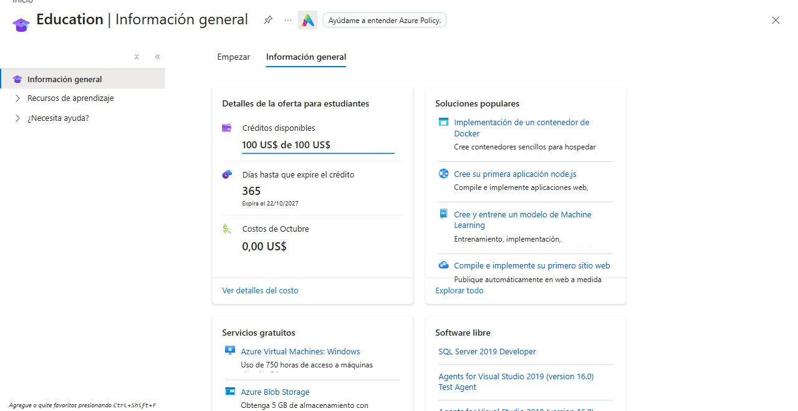

# TP3 · Configuración cloud y evidencia

Fecha: 22/10/2026. Configuración propuesta en [`infra/azure`](../../../infra/azure).
Los entregables distinguen lo observado en consola de lo que falta desplegar.

## Estado comprobado

| Elemento | Evidencia y estado |
|---|---|
| Azure para Estudiantes | Beneficio activo, USD 100 de USD 100 disponibles, consumo del mes USD 0; vencimiento 22/10/2027 |
| Recursos TP3 en Azure | No creados; falta aprobar uso de crédito |
| Firebase | Proyecto `finanzasapp-1f76a`, Spark, sin facturación vinculada |
| Firestore | Native Standard, regional Santiago `southamerica-west1`; reglas por UID e índices automáticos observados |
| Región Azure propuesta | `chilecentral`, seleccionable en el asistente; cuotas, políticas y capacidad efectivas aún sin verificar |
| Despliegue, balanceo y escalado real | Pendientes; Terraform validado con proveedor simulado |

La oferta descuenta del crédito el consumo que exceda las cantidades gratuitas.
Cuando se agota el crédito, Azure deshabilita la suscripción salvo que se cambie
a pago por uso. No se propone ese cambio. [Condiciones operativas oficiales](https://learn.microsoft.com/azure/cost-management-billing/manage/azurestudents-subscription-disabled).

## Recursos revisables antes de aplicar

| Recurso | Configuración propuesta |
|---|---|
| Grupo `rg-tp3-finanzas` | Agrupa exclusivamente recursos TP3, etiquetas de finalidad |
| Registro de contenedores | Basic privado en Brazil South, nombre único, administrador desactivado; ACR Tasks no disponible en Chile Central |
| Identidad `id-tp3-summary` | Sólo `AcrPull` sobre ese registro |
| Entorno `cae-tp3-finanzas` | Perfil Consumption, sin perfiles Dedicated, VNet, Private Endpoint ni workspace Log Analytics nuevo |
| App `ca-tp3-finanzas-summary` | Imagen privada por digest, revisión única, HTTPS público, puerto interno 8080 |
| Escalado | Mínimo 0, máximo 2, umbral HTTP 16; 0,25 vCPU / 0,5 GiB |
| Firebase | ID del proyecto existente; `FIREBASE_DATA_ACCESS=user-rest`, clave cliente en variable local |

La entrada pública es necesaria para Android. `/healthz` no divulga datos y el
resumen requiere un ID token válido. No se abre Firestore ni se cambian sus reglas.
La suscripción aprovisiona entornos Express y rechazó el destino `azure-monitor`.
Se omite `logs_destination`: sólo streaming, sin almacén ni retención adicional.
Capturar métricas de plataforma; cualquier retención debe presupuestarse aparte.

No se usan claves de cuenta de servicio Google ni contraseñas ACR. El estado de
Terraform, ID de suscripción y variables cliente se mantienen locales y fuera de
Git. La clave cliente no es una credencial administrativa; revisar sus
restricciones de API/aplicación antes de comprobar `accounts:lookup` desde Azure.
Si impiden el uso, detenerse y revisar sin eliminar protecciones automáticamente.

## Estimación para decidir

Precios públicos consultados para Chile Central en USD, 22/10/2026, conservados en
[`azure-retail-prices.json`](../evidence/azure-retail-prices.json).
Son tarifas de referencia; no son una factura de esta cuenta.

El registro se ubica en Brazil South porque ACR Tasks rechazó Chile Central.
Se verificaron las mismas tarifas Basic y Tasks en
[`azure-registry-brazil-prices.json`](../evidence/azure-registry-brazil-prices.json).
El reemplazo del registro vacío inicial puede agregar consumo parcial del registro;
el presupuesto de control contempla estos reintentos.

ACR Tasks también devolvió `TasksOperationsNotAllowed` para la oferta estudiantil
en Brazil South. Se usa la imagen construida y probada en GitHub Actions, exportada
como artefacto privado de un día. Se verifica SHA-256 al descargarla y se sube con
`crane` y un token temporal obtenido mediante la sesión local de Azure CLI.
No se entregan credenciales Azure a GitHub ni se crea otra identidad con escritura.
El token local se retira del almacén de `crane` al terminar. Los intentos de Tasks
fueron rechazados antes de iniciar una ejecución de construcción.

| Concepto | Tarifa observada | Escenario de demostración |
|---|---:|---:|
| CPU activa | 0,000034 por vCPU-s | Dos réplicas de 0,25 vCPU durante 1 h: USD 0,0612 |
| Memoria activa | 0,000004 por GiB-s | Dos réplicas de 0,5 GiB durante 1 h: USD 0,0144 |
| Solicitudes | USD 0,40 por millón | 1.000: USD 0,0004 |
| Registro Basic | USD 0,1666 por día | 1 día: USD 0,1666 |
| Construcción ACR Tasks | USD 0,0001 por vCPU-s | 2 vCPU durante 5 min: USD 0,06 |

Subtotal ilustrativo **USD 0,3026**, sin descontar franquicias ni incluir tráfico,
almacenamiento adicional, reintentos o servicios no previstos. El registro se
sigue cobrando aunque la app escale a cero, hasta eliminarlo. La franquicia de
Container Apps puede cubrir cómputo/solicitudes de esta demostración, según el
consumo de toda la suscripción. [Facturación oficial](https://learn.microsoft.com/azure/container-apps/billing).

Se propone reservar **hasta USD 5 del crédito** para una demostración de 24 h,
revisar consumo y retirar recursos al cerrar la evidencia. Es un presupuesto de
control: las métricas de costo tienen demora y no garantizan un corte exacto.
No se activa pago por uso ni se introduce tarjeta. Si cuotas/región o precio
obligan a cambiar estos recursos, revisar antes de crear una alternativa.

## Procedimiento posterior a la aprobación

1. Confirmar suscripción estudiantil, saldo y límite; revisar permisos para crear
   recursos y asignar `AcrPull`. Inspeccionar registro de `Microsoft.App`,
   `Microsoft.ContainerRegistry`, `Microsoft.ManagedIdentity` y cuotas/región.
   Registrar proveedores faltantes sólo en esta etapa autorizada.
2. Completar `terraform.tfvars` local desde el ejemplo. `approve_credit_usage`
   permanece `false` por defecto. Autenticar herramientas oficiales con la cuenta
   del usuario, sin guardar contraseñas/tokens en archivos del repositorio.
3. Ejecutar `init`, `validate` y `plan` con `deploy_app=false`; revisar que incluya
   exclusivamente el grupo, registro, identidad, rol y entorno previstos.
   Aplicar sólo ese plan revisado.
4. Construir y probar `backend/` en GitHub Actions; verificar el hash del artefacto
   privado y transferirlo al registro con la sesión local. La base Node está
   fijada por digest; revisar auditoría de producción y digest final. No publicar
   código privado ni credenciales Azure en un registro o artefacto público.
5. Cargar la clave cliente Firebase desde configuración Android existente sin
   imprimirla; ejecutar nuevo plan con `deploy_app=true` e imagen por digest.
   Aplicar después de revisar diferencias. Las dos fases evitan depender de una
   imagen inexistente o etiquetas mutables.
6. Comprobar HTTPS, health 200 y resumen sin token 401; ejecutar consulta con un
   usuario sintético propio. Probar reglas por UID y sesión revocada/deshabilitada
   sin acceder a usuarios existentes. No guardar tokens ni movimientos en logs.
7. Configurar Android con el origen real y probar la consulta autenticada.
   Capturar configuración efectiva y métricas antes/durante/después de la carga
   sintética acotada descrita en la estrategia. Revisar costo y saldo.
8. Guardar evidencia sin IDs personales, tokens o importes. Al terminar revisar
   el plan de eliminación del grupo exclusivo TP3, confirmar su alcance y retirar
   los recursos. La eliminación no incluye Firebase ni datos de usuarios del TP2.

No ejecutar estos pasos como prueba local. Actualmente faltan URL/digest reales,
permisos/cuotas efectivos, captura de reglas de escala desplegadas, métricas de
réplicas, consumo real y flujo Android contra la nube. La captura del beneficio
demuestra acceso a Azure, **no implementación del autoescalado**.
