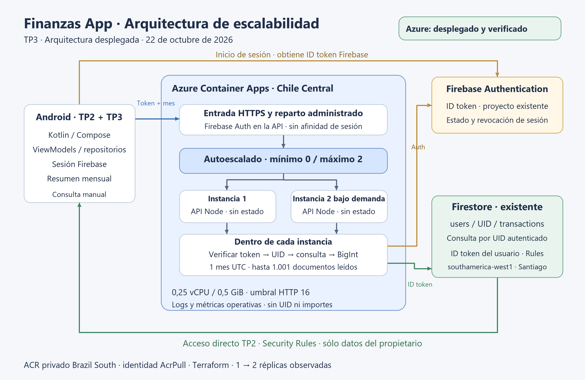
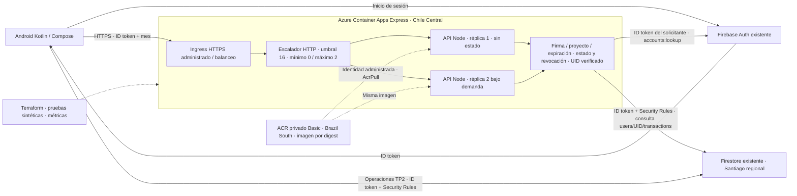
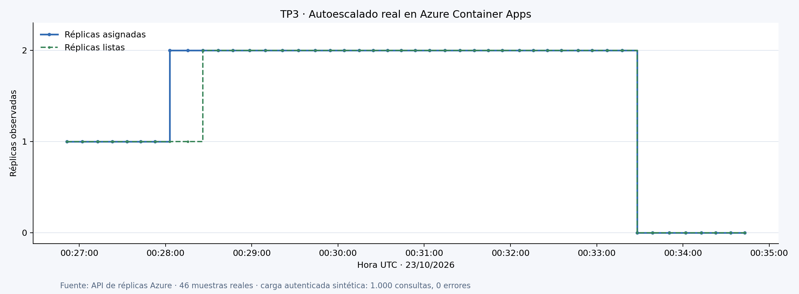

# TP3 · Arquitectura actualizada

Arquitectura Azure + Firebase desplegada y verificada, 22/10/2026 (Argentina).

Cada réplica tiene 0,25 vCPU / 0,5 GiB. El umbral HTTP es una señal de escalado,
no un límite de conexiones. Se observó crecimiento automático de una a dos
réplicas, ambas listas, y posterior reducción a cero; el diagrama no implica dos instancias permanentes.
Se acepta arranque en frío con mínimo
cero. No se configura redundancia entre zonas/regiones. El registro tiene costo
independiente de la cantidad de réplicas.

El backend no usa una cuenta administrativa Firebase: verifica la sesión y
consulta Firestore con el mismo ID token del usuario. La identidad Azure se
limita a descargar imágenes privadas; no accede a datos Google. Las operaciones
del TP2 permanecen en Firebase. El resumen agrega enteros exactos de un mes UTC y
no persiste datos, sesiones ni resultados financieros.

Fuente editable: este Mermaid y `scripts/render-architecture.py --azure --deployed` para PNG.
La variante Cloud Run previa se conserva en `docs/tp3/03-arquitectura.md`.

La curva usa [muestras reales](../evidence/azure-scale-observed.json); las réplicas
asignadas y las listas pueden diferir durante el arranque. La carga autenticada
fue de 1.000 consultas sintéticas sin errores (p95 883 ms). El ingress reparte
solicitudes entre réplicas saludables; esta curva por sí sola no mide cuántas
solicitudes atendió cada réplica.
