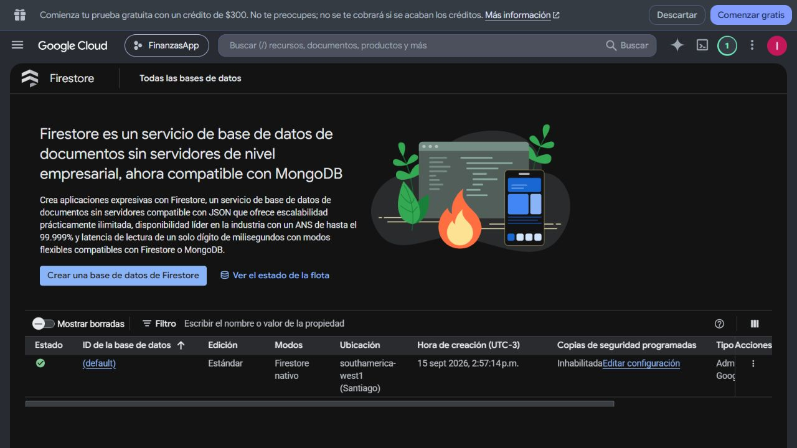
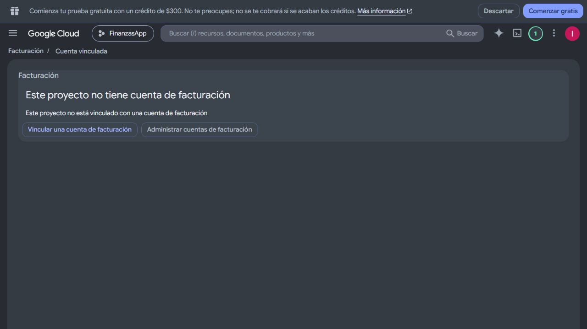

# TP3 · Revisión cloud en modo lectura

**Fecha:** 22/10/2026, aproximadamente 19:54 (Argentina).
**Proyecto:** `finanzasapp-1f76a`, nombre visible FinanzasApp.
**Autorización:** el usuario autorizó revisar Google Cloud sin generar cargos e
inició sesión directamente en la consola. No se habilitaron APIs, facturación,
presupuestos, cuentas de servicio ni recursos; no se abrieron documentos financieros.

## Hechos observados

| Elemento | Estado observado |
|---|---|
| Proyecto | FinanzasApp / `finanzasapp-1f76a` |
| Facturación | Mensaje explícito: el proyecto no tiene cuenta de facturación vinculada |
| Firestore | Base `(default)`, disponible, edición Estándar, modo nativo |
| Ubicación | `southamerica-west1` (Santiago), regional |
| Copias programadas | Inhabilitadas |
| Cifrado de Firestore | Administrado por Google |
| APIs existentes relevantes | Firestore, Identity Toolkit, Firebase Rules, Service Usage, Logging, Monitoring |
| APIs de Run / Cloud Build / Artifact Registry | Ausentes de la lista completa de 40 APIs habilitadas |
| IAM del nuevo runtime | Cuenta y rol propuestos; todavía no creados ni comprobados en cloud |
| Reglas activas de Firestore | Pendientes de comparación antes de cualquier publicación |

La región propuesta para Cloud Run y Artifact Registry pasa a Santiago para
coincidir con la base. Cloud Run está disponible allí según la
[lista oficial de ubicaciones](https://docs.cloud.google.com/run/docs/locations).
Esto no aprueba costos ni modifica la ubicación existente.

## Capturas reales de la consola

Estas imágenes muestran recursos existentes y el impedimento de facturación;
no son evidencia de un servicio Cloud Run desplegado.

Páginas consultadas: [Firestore](https://console.cloud.google.com/firestore/databases?project=finanzasapp-1f76a),
[facturación del proyecto](https://console.cloud.google.com/billing/linkedaccount?project=finanzasapp-1f76a),
[APIs habilitadas](https://console.cloud.google.com/apis/dashboard?project=finanzasapp-1f76a&show=all).
Requieren acceso a la cuenta del proyecto. No se incluyen correos ni credenciales
en el informe y no se publicaron capturas de movimientos reales.

## Paso pendiente

Para desplegar habrá que vincular una cuenta de facturación, aprobar el
presupuesto de la demostración y después habilitar sólo las APIs necesarias.
La autorización de inspección no autoriza esas acciones. Antes del despliegue
hay que revisar el plan, IAM efectivo, reglas e índices vigentes, imagen y costos.
La [guía de configuración](02-configuracion-cloud.md) deja el procedimiento preparado.
