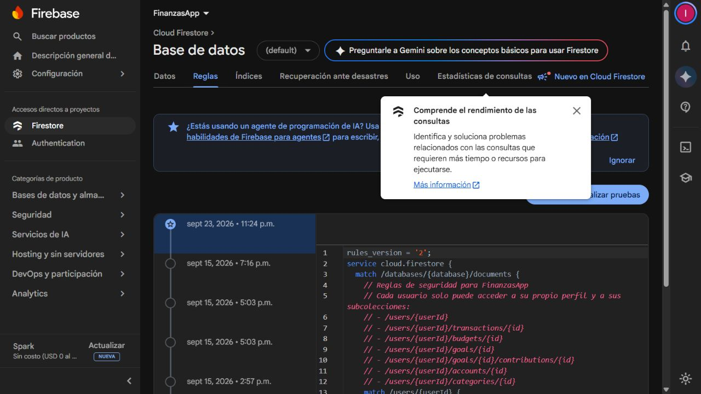

# TP3 · Revisión cloud en modo lectura

**Fecha:** 22/10/2026, aproximadamente 19:54 (Argentina).
**Proyecto:** `finanzasapp-1f76a`, nombre visible FinanzasApp.
**Autorización:** el usuario autorizó revisar Google Cloud sin generar cargos e
inició sesión directamente en la consola. No se habilitaron APIs, facturación,
presupuestos, cuentas de servicio ni recursos; no se consultaron movimientos ni
importes financieros reales.

## Hechos observados

| Elemento | Estado observado |
|---|---|
| Proyecto | FinanzasApp / `finanzasapp-1f76a` |
| Facturación | Mensaje explícito: el proyecto no tiene cuenta de facturación vinculada |
| Plan Firebase | Spark, sin costo mensual indicado por Firebase |
| Firestore | Base `(default)`, disponible, edición Estándar, modo nativo |
| Ubicación | `southamerica-west1` (Santiago), regional |
| Copias programadas | Inhabilitadas |
| Cifrado de Firestore | Administrado por Google |
| APIs existentes relevantes | Firestore, Identity Toolkit, Firebase Rules, Service Usage, Logging, Monitoring |
| APIs de Run / Cloud Build / Artifact Registry | Ausentes de la lista completa de 40 APIs habilitadas |
| IAM del nuevo runtime | Cuenta y rol propuestos; todavía no creados ni comprobados en cloud |
| Reglas activas de Firestore | Propietario por `request.auth.uid`, incluidas todas sus subcolecciones recursivamente |
| Índices | 0 manuales; configuración automática ascendente/descendente habilitada para colecciones |

La región propuesta para Cloud Run y Artifact Registry pasa a Santiago para
coincidir con la base. Cloud Run está disponible allí según la
[lista oficial de ubicaciones](https://docs.cloud.google.com/run/docs/locations).
Esto no aprueba costos ni modifica la ubicación existente.

La vista IAM muestra al usuario administrador con rol Propietario y una cuenta
Firebase Admin existente con permisos de administración de Auth y creación de
tokens. No se reutilizará esa cuenta como runtime del backend; la propuesta crea
una identidad separada con lectura acotada. No se quitaron ni ampliaron roles.
Esta lectura de IAM no reemplaza la validación de permisos del servicio futuro.

La versión publicada de reglas (23/09/2026, 23:24, según la consola) exige sesión
y coincidencia del UID tanto para el perfil como para todos sus descendientes.
La propuesta local conserva ese aislamiento y limita el acceso a colecciones
conocidas del TP2 y aportes a metas. Es más restrictiva que la vigente: no se
publicó y debe revisarse su impacto antes de reemplazar la política.
Se conserva un [extracto funcional](evidence/firestore-active.rules) de la regla
activa y una captura; se omitieron sólo comentarios descriptivos del original.
La consulta mensual sólo necesita el índice simple por fecha, compatible con
la configuración automática observada. No se modificaron ni crearon índices.

## Capturas reales de la consola

Estas imágenes muestran recursos existentes y el impedimento de facturación;
no son evidencia de un servicio Cloud Run desplegado.

Páginas consultadas: [Firestore](https://console.cloud.google.com/firestore/databases?project=finanzasapp-1f76a),
[facturación del proyecto](https://console.cloud.google.com/billing/linkedaccount?project=finanzasapp-1f76a),
[APIs habilitadas](https://console.cloud.google.com/apis/dashboard?project=finanzasapp-1f76a&show=all).
Requieren acceso a la cuenta del proyecto. No se incluyen correos ni credenciales
en el informe y no se publicaron capturas de movimientos reales.

## Paso pendiente

Para desplegar habrá que vincular una cuenta de facturación, aprobar el
presupuesto de la demostración y después habilitar sólo las APIs necesarias.
La autorización de inspección no autoriza esas acciones. Antes del despliegue
hay que revisar el plan, IAM efectivo, reglas e índices vigentes, imagen y costos.
La [guía de configuración](02-configuracion-cloud.md) deja el procedimiento preparado.
