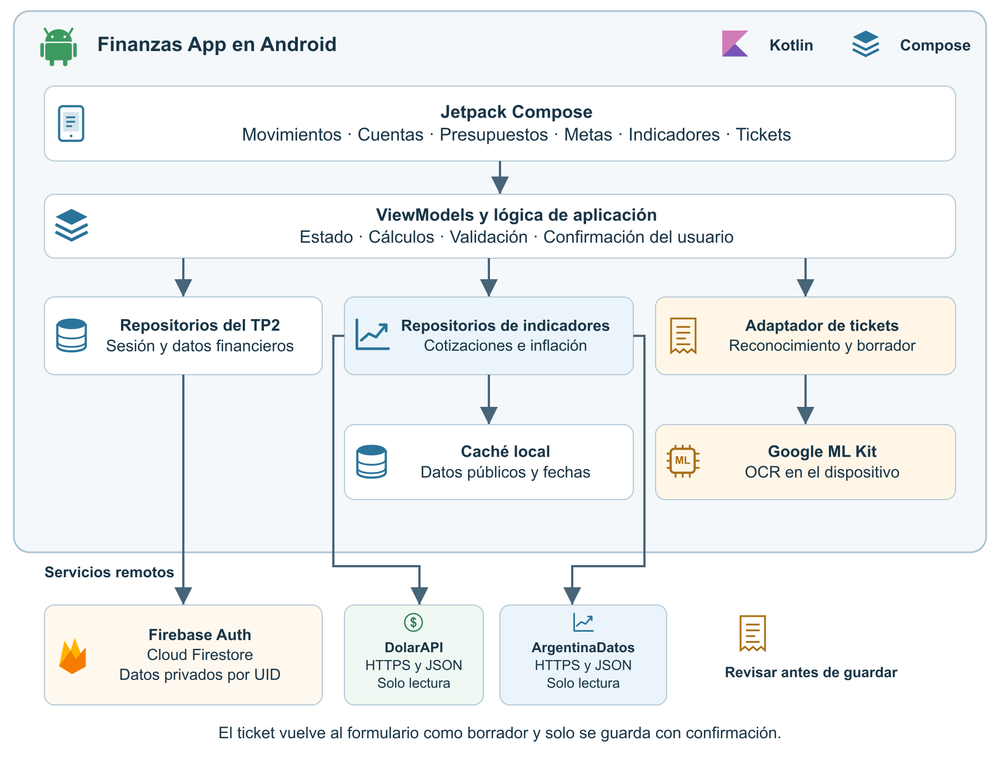

# TP7 Integración de APIs y SDKs

La aplicación parte del TP2 y conserva MVVM, Firebase Authentication y Firestore. Las nuevas integraciones se ejecutan en Android; no requieren infraestructura del TP3.

- **DolarAPI**: consulta HTTPS de cotizaciones, selección de mercado y equivalencia orientativa de ARS a USD usando venta.
- **ArgentinaDatos**: serie mensual y comparación entre dos meses mediante acumulación de factores; se rechazan períodos incompletos.
- **Google ML Kit**: OCR latino con modelo incluido. Cámara externa o selector de imágenes, revisión editable y confirmación antes de pasar al formulario de gastos.

## Acceso desde la aplicación

En Inicio, abrir **Cotizaciones e inflación**. Los indicadores permiten tomar un importe de un presupuesto o una meta, sin modificarlo. En **Nuevo movimiento**, seleccionar Gasto y usar **Tomar foto** o **Elegir imagen**. Luego revisar los candidatos, aceptar explícitamente cualquier redondeo y elegir cuenta y categoría antes de guardar.

El TP2 representa los movimientos en pesos enteros. Los centavos del OCR nunca se descartan sin confirmación. Los cálculos de indicadores usan `BigDecimal`.

## Componentes

`domain/FinancialIndicators.kt` contiene modelos y cálculos independientes de Android. `CachedIndicatorRepository` aplica exclusión de solicitudes concurrentes, caché de tres horas para dólar y un día para inflación, y espera entre reintentos fallidos. `HttpIndicatorSource` usa HTTPS con límites de tiempo y tamaño; `IndicatorJson` valida el contrato. `PreferencesIndicatorCache` persiste únicamente series públicas y sus fechas.

`MlKitReceiptRecognizer` encapsula el SDK y `ReceiptParser` genera candidatos, sin ejecutar escrituras. `ReceiptViewModel` controla la captura temporal y el propietario de la sesión. `TransactionsViewModel` y el repositorio Firestore comprueban el UID del borrador y reutilizan el identificador del movimiento cuando se reintenta un mismo guardado fallido.

Las imágenes de cámara se guardan temporalmente en una carpeta privada expuesta por `FileProvider`. Se eliminan al terminar o cancelar. Las imágenes elegidas por el usuario no se borran. No se guardan imágenes ni texto OCR completo en Firestore. ML Kit procesa el contenido localmente, pero sus términos contemplan métricas técnicas de uso y rendimiento.

## Compilación y pruebas

Con JDK y Android SDK configurados:

```powershell
.\gradlew.bat testDebugUnitTest assembleDebug lintDebug
```

Las pruebas locales cubren precisión decimal, compra frente a venta, acumulación de inflación, meses faltantes, contratos JSON, caché, errores de conexión, cancelación, candidatos OCR, cambio de usuario y reintentos de escritura. La lectura de imágenes reales, cámara, permisos del sistema, accesibilidad y funcionamiento completo con Firestore deben verificarse en un dispositivo o emulador disponible. No se incluyen pruebas ficticias como evidencia de ejecución del SDK.

## Arquitectura y fuentes



La versión vectorial editable está en [arquitectura.svg](arquitectura.svg); se genera con `scripts/render_tp7_architecture.py`. Los símbolos son ilustrativos.

- [Repositorio](https://github.com/IgnacioMaidana7/finanzas-app-android)
- [DolarAPI](https://dolarapi.com/docs/argentina/operations/get-dolares)
- [ArgentinaDatos](https://argentinadatos.com/docs/operations/get-finanzas-indices-inflacion)
- [ML Kit para Android](https://developers.google.com/ml-kit/vision/text-recognition/v2/android)
- [Privacidad de ML Kit](https://developers.google.com/ml-kit/terms)
- [Uso de DolarAPI](https://ar.dolarapi.com/docs/uso)
- [Uso de ArgentinaDatos](https://argentinadatos.com/docs/uso)
