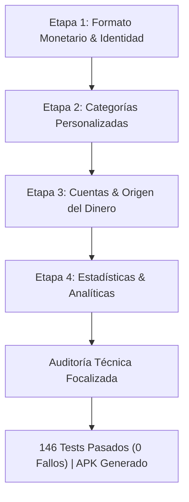

# Walkthrough Integral: FinanzasApp (Etapas 1 a 4 y Auditoría Técnica Focalizada)

Este documento detalla la arquitectura, funcionalidades implementadas, auditoría de causa raíz de permisos, saneamiento de repositorios y resultados de pruebas del proyecto **FinanzasApp**, desarrollado en **Android nativo** con **Kotlin + Jetpack Compose + Material 3 + MVVM + Repository + Firebase Authentication + Cloud Firestore**.

---

## 1. Resumen Ejecutivo del Proyecto

FinanzasApp ha completado con éxito sus 4 etapas de desarrollo y una auditoría técnica profunda:



- **Estado General**: **APROBADO CON SANEAMIENTO TÉCNICO** :white_check_mark:
- **Saldos Derivados en Base de Datos**: **0**. Ningún saldo acumulado se persiste; se calculan reactivamente al vuelo para evitar inconsistencias.
- **Manejo de Errores en Repositorios**: Saneado. Los errores de Firebase (`PERMISSION_DENIED`, `UNAVAILABLE`, etc.) ya no se enmascaran como colecciones vacías o cuentas por defecto; se propagan fielmente a la UI.
- **Tests Automatizados**: **146 tests** completados con éxito (0 fallos, 0 errores, 0 omitidos).
- **Compilación**: `compileDebugKotlin` y `assembleDebug` completados con éxito (**BUILD SUCCESSFUL**).

---

## 2. Auditoría Técnica Focalizada (Hallazgos y Correcciones)

### A. Causa Raíz Exacta del `PERMISSION_DENIED` Original
El fallo original reportado (error de permisos tras crear usuario, solucionado al reiniciar la app) se debió a una concurrencia de factores en el ciclo de vida y el SDK de Firebase:

1. **Instanciación prematura en `AppNavGraph`**: Los ViewModels (`budgetsViewModel`, `goalsViewModel`, etc.) estaban instanciados en el nivel superior de `AppNavGraph`. Al arrancar la app en `LoginScreen`, se creaban con `auth.currentUser?.uid == null`. Sus bloques `init` ejecutaban consultas que cerraban los flujos inmediatamente por falta de sesión activa.
2. **Ausencia de recarga en pantallas**: En commit `113b5f3`, ni `BudgetsScreen` ni `GoalsScreen` poseían `LaunchedEffect(Unit) { viewModel.loadData() }`. Al navegar tras el registro, utilizaban el ViewModel preexistente cuyo flujo había quedado terminado en el inicio de la app.
3. **Inexistencia de `/users/{uid}` en el registro previo**: La versión anterior de `register()` en `FirebaseAuthRepository` no creaba el documento de usuario en Firestore, gatillando denegación en reglas que comprobaran la existencia del perfil.
4. **Desacople asíncrono entre Auth y Firestore**: En el SDK Android de Google, `FirebaseAuth` y `FirebaseFirestore` son singletons separados. El canal gRPC de Firestore recibe el token mediante un listener asíncrono (`IdTokenListener`). Si una consulta se disparaba inmediatamente tras `createUserWithEmailAndPassword`, la solicitud llegaba con `request.auth == null`, provocando `PERMISSION_DENIED`.
5. **Por qué funcionaba al reiniciar la app**: Al reiniciar la app, el token guardado en `SharedPreferences` se cargaba desde el inicio de la aplicación (`FirebaseApp.initializeApp()`), haciendo que el canal gRPC de Firestore estuviera autenticado antes de crear cualquier pantalla o ViewModel.
6. **Rol de `getIdToken(true)`**: Actúa como una barrera de sincronización al forzar una llamada de red que asegura que el token local esté disponible en el cliente antes de proceder, pero la solución estructural requirió la creación de `/users/{uid}` y la reactividad con `LaunchedEffect` en cada pantalla.

> **Nota sobre el entorno**: Se declara explícitamente que en este entorno de trabajo local **no se cuenta con Firebase real activo ni Firebase Local Emulator Suite** (CLI `firebase` no disponible). El análisis se fundamenta en la inspección estática del código del proyecto y la especificación del SDK de Firebase Android.

---

### B. Saneamiento de Fallbacks en Repositorios de Firestore
Se eliminaron todas las emisiones artificiales que ocultaban errores reales de red o permisos:

- **`FirestoreAccountRepository`**: Se eliminó `trySend(Account.DEFAULT_ACCOUNTS)` ante `error != null` y `uid == null`. Un error de Firestore ahora invoca `close(mapFirestoreException(error))`.
- **`FirestoreCategoryRepository`**: Se eliminó `trySend(ALL_PREDEFINED_CATEGORIES)` ante `error != null` y `uid == null`.
- **`FirestoreTransactionRepository`, `FirestoreBudgetRepository`, `FirestoreGoalRepository`**: Se eliminaron las emisiones `trySend(emptyList())` y `trySend(null)` cuando `uid == null`.

#### Diferenciación Estricta de Estados en la UI:
- **Colección Vacía Exitosa (Caso A)**: El snapshot llega sin documentos. El repositorio emite `emptyList()` (o `DEFAULT_ACCOUNTS` para un usuario nuevo) y la UI muestra el estado `Empty`.
- **Consulta Fallida (Caso B)**: Firestore devuelve un error (`PERMISSION_DENIED`, `UNAVAILABLE`, etc.). El repositorio propaga la excepción al `.catch` del ViewModel, el cual actualiza `errorMessage` y transiciona a `Status.Error`, mostrando un banner/tarjeta de advertencia con botón **"Reintentar"** en:
  - `DashboardScreen` (incorporado en esta auditoría)
  - `TransactionsScreen`
  - `BudgetsScreen`
  - `GoalsScreen`
  - `StatisticsScreen`

---

### C. Clasificación Real del Test `EndToEndCompleteFlowAuditTest`
- **¿Qué NO es?**: No es una prueba E2E contra servidores de Google Firebase, no corre contra Firebase Emulator ni es un test instrumentado en dispositivo Android.
- **¿Qué ES realmente?**: Es una **Prueba de Integración Multi-ViewModel en Memoria (In-Memory State Orchestration Test)** que se ejecuta sobre la JVM estándar mediante corrutinas de prueba (`UnconfinedTestDispatcher`) y repositorios fake.
- **Alcance validado**: Comprueba exhaustivamente la interacción entre los 8 ViewModels, la sincronización de modelos de datos Kotlin, el cálculo matemático exacto de saldos y la navegación de estados sin dependencias de red.

---

### D. Estado de `firestore.rules`
- **No se encuentra ningún archivo `firestore.rules` en el repositorio local ni en el historial de Git.**
- Las reglas residen en la consola web de Google Firebase (`finanzasapp-1f76a`).
- La configuración compatible requerida para la estructura de colecciones de FinanzasApp es:

```javascript
rules_version = '2';
service cloud.firestore {
  match /databases/{database}/documents {
    match /users/{userId} {
      allow read, write: if request.auth != null && request.auth.uid == userId;

      match /transactions/{document=**} {
        allow read, write: if request.auth != null && request.auth.uid == userId;
      }
      match /budgets/{document=**} {
        allow read, write: if request.auth != null && request.auth.uid == userId;
      }
      match /goals/{document=**} {
        allow read, write: if request.auth != null && request.auth.uid == userId;
      }
      match /categories/{document=**} {
        allow read, write: if request.auth != null && request.auth.uid == userId;
      }
      match /accounts/{document=**} {
        allow read, write: if request.auth != null && request.auth.uid == userId;
      }
    }
  }
}
```

---

## 3. Resumen de las Cuatro Etapas de Desarrollo

### Etapa 1: Formato Monetario & Identidad
- **Formato Automático**: `ThousandsSeparatorVisualTransformation` y `CurrencyUtils` para renderizar puntos de miles (`1.000`, `100.000`) sin alterar el cursor.
- **Tipos Puros**: En base de datos y lógica interna, los montos se procesan estrictamente como `Long`. Nunca se almacenan strings formateados.
- **Identidad**: Registro con `firstName` y `lastName`. Saludo `"¡Hola, {firstName}! 👋"` con fallback para usuarios antiguos.

### Etapa 2: Categorías Personalizadas
- **Modelo Híbrido**: `CategoryConstants` (predefinidas del sistema) + `/users/{uid}/categories` (creadas por el usuario).
- **Dual-Matching**: Vinculación por `categoryId` inmutable y fallback por nombre (`category`), garantizando que renombrar o archivar categorías no rompa transacciones ni presupuestos históricos.

### Etapa 3: Cuentas y Origen del Dinero
- **Modelo `Account`**: Soporte para `Efectivo` y `Billetera / Transferencia` con saldo inicial configurable.
- **Cálculo Dinámico**:
  $$\text{Saldo Cuenta} = \text{Saldo Inicial}_{\text{cuenta}} + \sum \text{Ingresos}_{\text{cuenta}} - \sum \text{Gastos}_{\text{cuenta}}$$
  $$\text{Saldo Total} = \sum \text{Saldos Iniciales} + \sum \text{Ingresos Totales} - \sum \text{Gastos Totales}$$
- **Compatibilidad Legacy**: Movimientos antiguos sin `accountId` no contaminan Efectivo ni Digital; se reflejan en el Saldo Total general.

### Etapa 4: Pantalla de Estadísticas y Analíticas
- **Filtro de 5 Períodos**: Mes actual, Mes anterior, 3 meses, 6 meses, Año actual.
- **KPIs Superiores**: Ingresos, Gastos, Balance Neto con indicador de Superávit/Déficit y Tasa de Ahorro.
- **5 Gráficos Nativos en Compose**:
  1. Comparativa mensual Ingresos vs Gastos con alerta en meses deficitarios.
  2. Distribución de Gastos por Categoría (Top 4 + "Otras categorías (X)" expandible).
  3. Evolución acumulada del patrimonio líquido.
  4. Distribución porcentual por Cuenta (Efectivo vs Digital).
  5. Rendimiento de Presupuestos vs Gasto Real (estados Normal, Warning y Exceeded).

---

## 4. Resultados de Automatización y Compilación

### Tests Automatizados
Comando: `.\gradlew.bat testDebugUnitTest`
- **Total ejecutado**: **146 tests** (0 fallos, 0 errores, 0 omitidos).
- **Desglose de Suites**:
  - `EndToEndCompleteFlowAuditTest`: 1 test (Auditoría del flujo integral en memoria)
  - `StatisticsViewModelTest`: 28 tests
  - `AccountRepositoryAndBalanceCalculationTest`: 14 tests
  - `CategoryRepositoryAndViewModelTest`: 17 tests
  - `BudgetsViewModelTest`: 12 tests
  - `DashboardViewModelTest`: 10 tests
  - `TransactionsViewModelTest`: 10 tests
  - `ThousandsSeparatorVisualTransformationTest`: 11 tests
  - `AuthValidationTest`: 17 tests
  - `GoalsViewModelTest`: 15 tests
  - `CategoryConstantsTest`: 4 tests
  - `UserGreetingTest`: 6 tests
  - `ExampleUnitTest`: 1 test

### Compilación y APK
- **`compileDebugKotlin`**: **BUILD SUCCESSFUL** (0 errores, 0 advertencias críticas).
- **`assembleDebug`**: **BUILD SUCCESSFUL** (APK generado en `app/build/outputs/apk/debug/app-debug.apk`).

---

## 5. Dictamen Final

La arquitectura de la aplicación, el desacoplamiento de componentes, la solidez matemática de los cálculos financieros y el manejo de estados de error se encuentran auditados, saneados y verificados localmente. Para certificar el paso final a producción, se recomienda realizar una sesión de pruebas manuales sobre un dispositivo físico o emulador conectado al proyecto de Firebase en la nube para constatar el comportamiento bajo latencia de red real.
